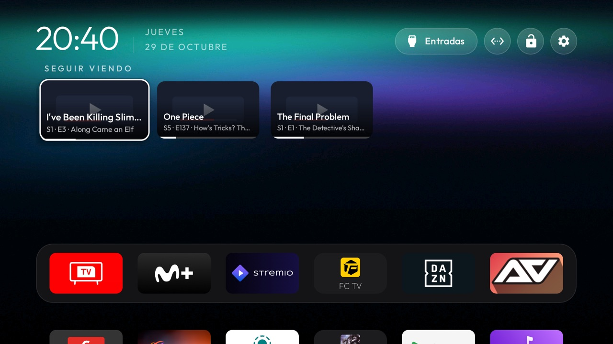

# Seguir viendo

What you left half-watched, on Home. Seguir viendo reads your [Trakt](https://trakt.tv) account, where Stremio on
this TV and Kodi on any other device scrobble what you watch, and publishes each paused episode or film as a row in
Android TV's Continue watching (Watch Next) table. Any home screen that reads that table shows them; in this fork the
launcher's `continue_watching` row does (`FORK.md`). OK on a row opens Stremio.



- **Your own rows only.** It writes rows under its own package and replaces them on each sync, so a show you finish
  on another device leaves the row at the next sync. Other apps' rows are never touched.
- **Opens the app, not itself.** Each row opens a small trampoline in this app, which starts Stremio (or shows that
  Stremio is not installed). The launcher only follows a row's link when it points at the app that published it, so
  the trampoline is what lets a row from here open Stremio.
- **No posters yet.** Trakt has no images; until a later version adds them the launcher shows this app's banner.

## Setting it up

1. Create an application at <https://trakt.tv/oauth/applications/new>: any name, no permissions ticked. A
   Development application only accepts a loopback redirect URI, so give it `http://127.0.0.1`. The sign-in on the
   TV never opens it; Trakt only checks it matches when the app renews its session.
2. Put its keys in `addons/seguir-viendo/local.properties` (git ignores the file, so they never reach a commit):

   ```properties
   sdk.dir=/path/to/Android/sdk
   trakt.clientId=<Client ID>
   trakt.redirectUri=http://127.0.0.1
   ```

   Trakt no longer issues a client secret for new applications ("Client Secret: Not issued", PKCE): the app signs
   in with a PKCE challenge instead. Add `trakt.clientSecret=<Client Secret>` only for an older application that has
   one, and leave `trakt.redirectUri` out only if it was registered with `urn:ietf:wg:oauth:2.0:oob`.

3. Build and install (below), open **Seguir viendo**, choose **Connect Trakt** and enter the code it shows at
   <https://trakt.tv/activate> from your phone. No password is typed on the TV.
4. Choose **Sync now**. Without the keys the app says so and the Trakt part stays off.

## Build and install

From the repository root:

```bash
cd addons/seguir-viendo && ./gradlew assembleRelease && cd ../..
TV_HOST=<tv ip> tools/venv/bin/python -I tools/tv.py --push addons/seguir-viendo/app/build/outputs/apk/release/app-release.apk /data/local/tmp/addon.apk
TV_HOST=<tv ip> tools/venv/bin/python -I tools/tv.py 'pm install -r /data/local/tmp/addon.apk; rm -f /data/local/tmp/addon.apk'
```

## Permissions

| Permission | Why |
|---|---|
| `INTERNET` | To reach `api.trakt.tv` for the sign-in and the paused items; nothing else goes online |
| `com.android.providers.tv.permission.WRITE_EPG_DATA` | To write its own rows to the system's Watch Next table |

No background service and no telemetry: it syncs when you press **Sync now** or right after you connect.

## What it stores on the TV

The Trakt tokens, encrypted with a key held in Android Keystore, in the app's private storage, and the time of the
last sync. Tokens never appear in logcat. Removing the app removes them; revoking the app at
<https://trakt.tv/oauth/authorized_applications> ends the session from the Trakt side.

## Tested on

TCL 55C725 (Android TV 11) with this fork's launcher: Trakt connected with the device code (PKCE application, no
client secret), three episodes paused in Stremio shown in the Continue watching row with their progress, and OK on
a card opening Stremio.
