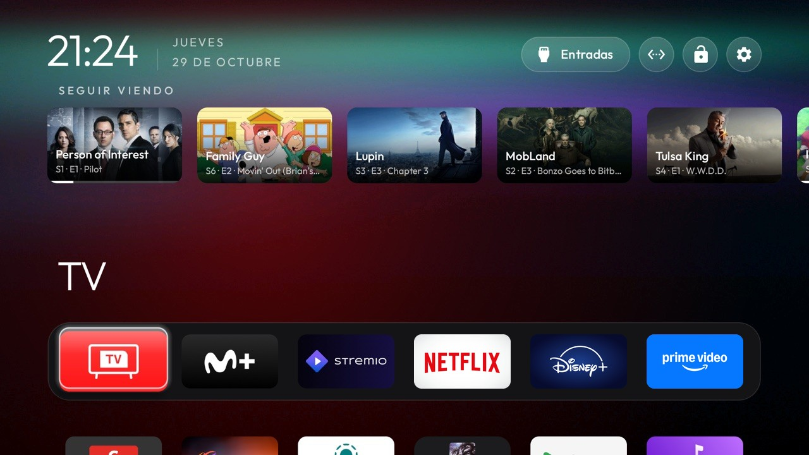

# Seguir viendo

What you left half-watched, on Home. Seguir viendo reads your [Trakt](https://trakt.tv) account, where Stremio on
this TV and Kodi on any other device scrobble what you watch, and your Movistar Plus account, whose app keeps its own
history. It publishes each paused episode or film as a row in Android TV's Continue watching (Watch Next) table. Any
home screen that reads that table shows them; in this fork the launcher's `continue_watching` row does (`FORK.md`).
OK on a Trakt row opens Stremio, on a Movistar Plus row the official Movistar Plus app.



- **Your own rows only.** It writes rows under its own package and replaces them on each sync, so a show you finish
  on another device leaves the row at the next sync. Other apps' rows are never touched.
- **Opens the app, not itself.** Each row opens a small trampoline in this app, which starts Stremio (or shows that
  Stremio is not installed). The launcher only follows a row's link when it points at the app that published it, so
  the trampoline is what lets a row from here open Stremio.
- **Next episodes too.** For each show you watched in the last 60 days and have nothing paused in, the next unwatched
  episode gets an "up next" row.
- **Artwork from TMDB, served locally.** Trakt has no images, so with a TMDB key the app fetches each show's or film's
  wide backdrop once, keeps it in its cache and hands the launcher a `content://` address: the launcher, which has no
  network access, reads the picture from this app. Without a key the launcher shows this app's banner.
- **Straight to the episode.** In Stremio a row opens that episode's or film's page, by its IMDb id; when Trakt has no
  IMDb id, or the app is set to Kodi, it opens the app.
- **Movistar Plus first, three at most.** The last three things you left unfinished in Movistar Plus come before the
  Trakt rows, with Movistar's own artwork, and open their page in the official app.
- **Hide what you won't finish.** Hold OK on a card in the launcher's row and this app shows a menu next to the card,
  drawn like the launcher's own app-tile menu (below the card, or above it when it does not fit; centred when the
  launcher sends no position): **Hide this episode**, **Hide season N** or **Hide the series** (for a film, **Don't
  show again**). The rows it covers leave Watch Next at once and are not published again, until the **Hidden from
  Continue watching: N** button on this app's screen shows them all again. It hides within one source: a series hidden
  from Trakt still shows from Movistar Plus. Nothing changes in Trakt or Movistar Plus, so Kodi and other devices
  still see the pause.

## Setting it up

1. Create an application at <https://trakt.tv/oauth/applications/new>: any name, no permissions ticked. A
   Development application only accepts a loopback redirect URI, so give it `http://127.0.0.1`. The sign-in on the
   TV never opens it; Trakt only checks it matches when the app renews its session.
2. Put its keys in `addons/seguir-viendo/local.properties` (git ignores the file, so they never reach a commit):

   ```properties
   sdk.dir=/path/to/Android/sdk
   trakt.clientId=<Client ID>
   trakt.redirectUri=http://127.0.0.1
   ```

   For artwork, add `tmdb.apiKey=<key>`: a TMDB account's API key or API read access token, both on
   <https://www.themoviedb.org/settings/api>. Without it the rows have no artwork.

   Trakt no longer issues a client secret for new applications ("Client Secret: Not issued", PKCE): the app signs
   in with a PKCE challenge instead. Add `trakt.clientSecret=<Client Secret>` only for an older application that has
   one, and leave `trakt.redirectUri` out only if it was registered with `urn:ietf:wg:oauth:2.0:oob`.

3. Build and install (below), open **Seguir viendo**, choose **Connect Trakt** and enter the code it shows at
   <https://trakt.tv/activate> from your phone. No password is typed on the TV.
4. Choose **Sync now**. Without the keys the app says so and the Trakt part stays off.
5. **Open in** switches the app the rows open between Stremio and Kodi, whichever is installed. **Disconnect** signs
   out: it deletes the Trakt tokens, this app's rows and the stored artwork, and stops the hourly sync.

## Movistar Plus

> **Unofficial API.** Movistar Plus has no public API. The add-on uses the one behind the web player at
> `ver.movistarplus.es`, the same that Kodi's Movistar+ add-on uses. Movistar can change or close it at any time, and
> then the Movistar Plus rows stop updating until the add-on is changed; the Trakt rows are not affected.

The protocol was learnt from [Paco8/plugin.video.movistarplus](https://github.com/Paco8/plugin.video.movistarplus)
(GPL-2.0), used only as a reference: no code was copied from it. The official TV app signs its requests with keys
hidden in the app, so the add-on does not use its API. The notes from that work are in [`docs/movistar.md`](docs/movistar.md).

1. Open **Seguir viendo** and choose **Connect Movistar Plus**.
2. Enter the email and password of the account. Movistar's web login gives no renewable session (the token lasts ten
   days and there is no refresh token), so the password is kept, encrypted, to sign in again by itself.
3. Pick one of the devices already registered on the account, for example the TV app's. The add-on borrows it rather
   than taking one of the account's device slots. Only an account with no device at all gets a new one, and only
   after a warning you confirm.
4. Pick the profile whose history the rows show; the main profile is the default. **Profile** changes it later.
5. **Sync now** under Movistar Plus syncs only Movistar Plus, as the one under Trakt syncs only Trakt. When the
   password stops working, the source shows "reconnect needed" and keeps its last rows.
   **Disconnect** deletes everything the add-on kept for the account and its rows.

## Build and install

From the repository root:

```bash
cd addons/seguir-viendo && ./gradlew assembleRelease && cd ../..
TV_HOST=<tv ip> tools/venv/bin/python -I tools/b64push.py addons/seguir-viendo/app/build/outputs/apk/release/app-release.apk /data/local/tmp/addon.apk
TV_HOST=<tv ip> tools/venv/bin/python -I tools/tv.py 'pm install -r /data/local/tmp/addon.apk; rm -f /data/local/tmp/addon.apk'
```

`tools/b64push.py` sends the APK through plain shell commands and checks its md5; `tools/tv.py --push` can stall on
some TVs over Wi-Fi.

On TCL firmware the hourly sync only runs if the app may start in the background. Allow it once:

```bash
TV_HOST=<tv ip> tools/venv/bin/python -I tools/tv.py 'appops set io.github.eltorres.seguirviendo APP_AUTO_START allow'
```

An update with `pm install -r` keeps that setting; removing the app drops it. `am force-stop` cancels the scheduled
sync until the app is opened again.

## Permissions

| Permission | Why |
|---|---|
| `INTERNET` | To reach `api.trakt.tv`, TMDB for artwork and the Movistar Plus web services (`auth.dof6.com`, `clientservices.dof6.com`, `perso.dof6.com`, `grmovistar.imagenio.telefonica.net`, and `estatico.emisiondof6.com` for its pictures); nothing else goes online |
| `com.android.providers.tv.permission.WRITE_EPG_DATA` | To write its own rows to the system's Watch Next table |
| `ACCESS_NETWORK_STATE` | So the hourly sync waits until the TV has a network |
| `RECEIVE_BOOT_COMPLETED` | To sync once when the TV starts and keep the hourly sync across restarts |

It also has an exported activity, `OptionsActivity`, that the launcher opens on a long press with the action
`com.gathin.tvhome.action.CONTINUE_WATCHING_OPTIONS` and a Watch Next row id (`docs/watch-next.md`): it only finds
this app's own rows and hides nothing until you choose an option.

It also has a read-only content provider, `io.github.eltorres.seguirviendo.posters`, that any app can read: it answers
only to opaque image ids and returns only the artwork, so the launcher can draw it without network access.

## Background work

While Trakt or Movistar Plus is connected, Android's JobScheduler runs a sync about once an hour, only when there is a network, and
once after the TV starts. Nothing runs in the foreground and there is no persistent service. It also syncs when you
press **Sync now**, right after you connect and after you change **Open in**. No telemetry.

## What it stores on the TV

Encrypted with a key held in Android Keystore, in the app's private storage:

- **Trakt:** the tokens.
- **Movistar Plus:** the account's email and password, the session token and when it expires, the account number,
  the account's user and platform ids, the id of the device it borrows and the chosen profile.

In plain app preferences: the app chosen in **Open in**, the time of the last sync and, in `hidden`, what you hid
(the source's ids of each episode, season, series or film, 200 at most, the oldest dropped first). In its cache: the artwork of
the rows on screen (older pictures are deleted at each sync).

Tokens and passwords never appear in logcat. Removing the app or choosing **Disconnect** removes them. Revoking the
app at <https://trakt.tv/oauth/authorized_applications> ends the Trakt session from the Trakt side; changing the
Movistar Plus password ends that one.

## Credits

This product uses the TMDB API but is not endorsed or certified by TMDB. Viewing data comes from Trakt and Movistar
Plus. Not affiliated with, endorsed or supported by Telefónica or Movistar Plus. Font: Outfit (SIL Open Font
License, `FONT-LICENSE-OFL.txt`).

## Tested on

TCL 55C725 (Android TV 11) with this fork's launcher and Stremio 1.12.0: Trakt connected with the device code (PKCE
application, no client secret), paused episodes and next episodes in the Continue watching row with TMDB artwork and
their progress, OK on a card opening that episode in Stremio, a newly paused episode arriving with the scheduled sync,
and Disconnect emptying the row and stopping the sync. Movistar Plus 26.06.103: connected with email and password
on a device already registered on the account, the last three unfinished episodes first in the row with Movistar's
artwork, OK opening their page in the official app, and the hourly sync after `APP_AUTO_START` was allowed.
